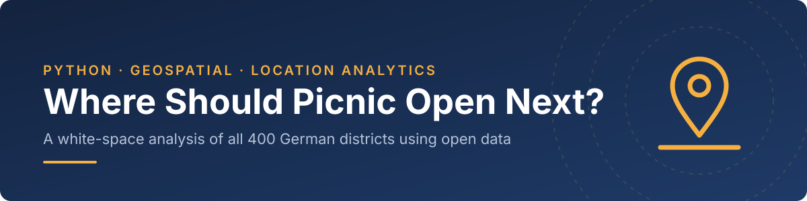
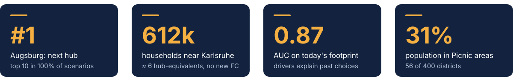
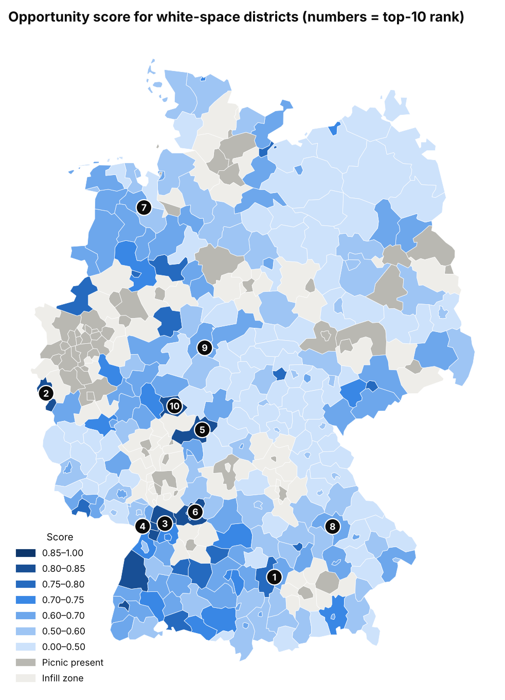
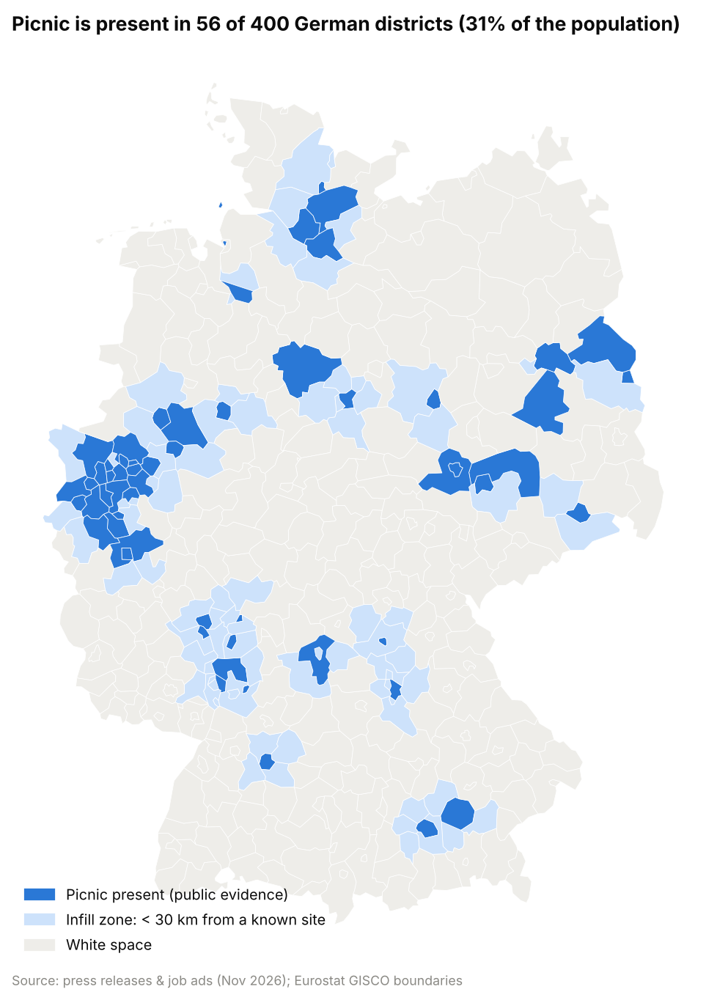
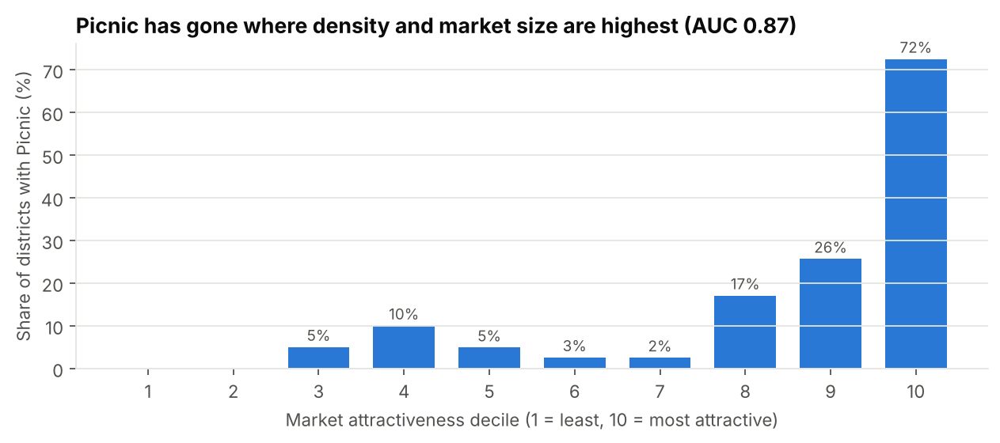
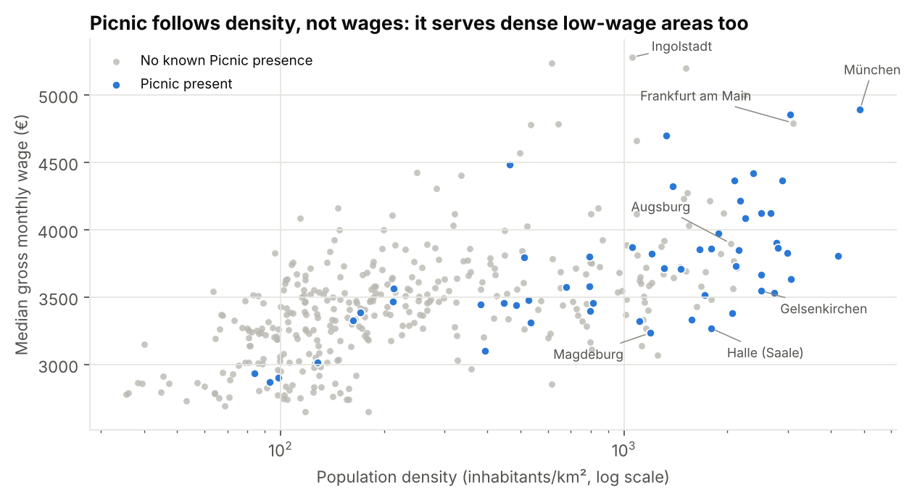
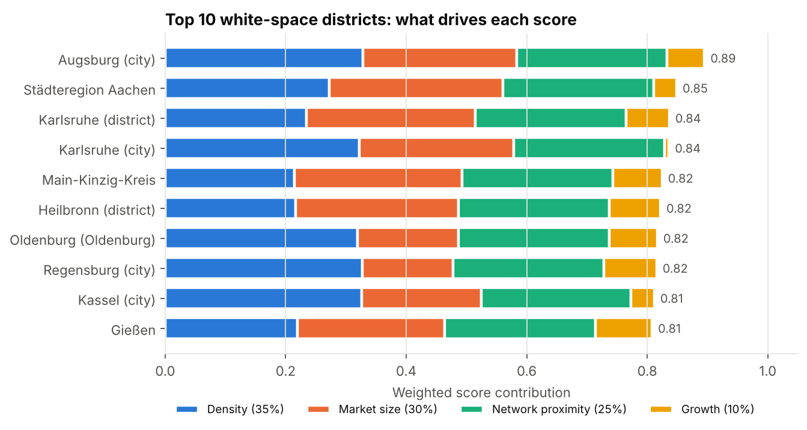
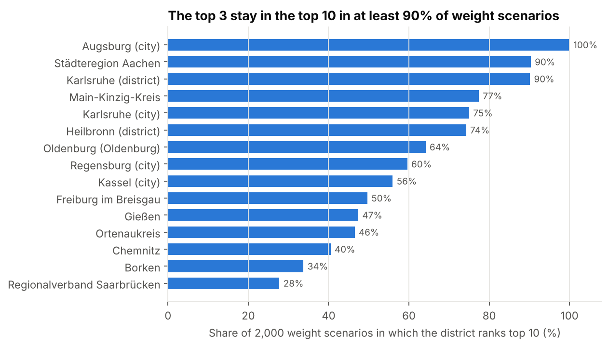

[](images/banner.svg)


[Background](#project-background) · [Key Metrics](#key-metrics) · [Summary](#executive-summary) · [Insights](#insights-deep-dive) · [Recommendations](#recommendations) · [Repository](#repository-and-how-to-run)

> A screening of all **400 German districts** to find where the online supermarket Picnic should open its next delivery hub. It uses open data only: population, area, growth and wages, plus Picnic's footprint rebuilt from public evidence. The answer is **Augsburg**, then the **Karlsruhe region** and **Aachen**. They are dense, sizeable markets with no known Picnic presence, each 40–70 km from the existing network. Augsburg ranks first in **100%** of 2,000 weight scenarios.

<a id="project-background"></a>
[](images/h_background.svg)

Picnic delivers groceries with a "milkman" model: orders are picked in a regional **fulfilment centre**, trucked to a local **hub**, and delivered from there by small electric vans on fixed daily routes. Two things decide whether a new hub works:
- **Density.** More households per km² means more drops per route hour, so a lower cost per order.
- **Supply.** A hub has to be within trucking range of a fulfilment centre. Building a new one is a much bigger investment.

Picnic has grown from the Rhine-Ruhr area into Hamburg, Berlin, Hannover/Bremen, Rhine-Main, Stuttgart, Munich/Franconia and central Germany. This project answers four questions:

1. Where is Picnic present today, and where is the **white space**?
2. Do density, market size, growth and income explain **where Picnic has already gone**?
3. Which white-space districts are the **most attractive** for the next hub, and how robust is that ranking?
4. **How big** are the top locations, measured in households and hubs?

<a id="key-metrics"></a>
[](images/h_metrics.svg)

[](images/kpi_cards.svg)

<a id="executive-summary"></a>
[](images/h_summary.svg)

[](outputs/04_opportunity_map.png)

| Priority location | White-space rank | Top 10 in weight scenarios | Households in ≤30 km cluster | Hub-equivalents* | Distance to Picnic network |
|---|---|---|---|---|---|
| **Augsburg** | **#1** | **100%** | ~350k | 3.5 | 53 km (Munich) |
| **Karlsruhe region** | #3 / #4 | 90% / 75% | **~612k** | **6.1** | 46–54 km; 60–70 km to Viernheim FC |
| **Aachen** | #2 | 90% | ~281k | 2.8 | 40 km (Rhine-Ruhr) |

*\*Upper bound: cluster households ÷ 100k households per hub (Picnic launches range from 80k to 125k).*

**What this means**

- **Augsburg is the clearest next step:** the densest large city without Picnic (≈2,050 inh/km²), first whatever the weights, and an extension of the Munich cluster.
- **Karlsruhe is the biggest prize:** the largest contiguous white-space market (~612k households), within reach of the existing **Viernheim** fulfilment centre. Several hubs could open without a new one.
- **Aachen is a low-risk fill-in** on the western edge of Picnic's home region.
- **Income does not belong in the score.** Holding density and size constant, higher wages are linked to a *lower* chance of Picnic presence, which fits a low-price, mass-market proposition.

<a id="insights-deep-dive"></a>
[](images/h_insights.svg)

### 1. Picnic already reaches about a third of Germany
[Notebook, section 4](notebooks/picnic_next_hub_germany.ipynb)

[](outputs/01_footprint_map.png)

Picnic publishes no coverage map, so the footprint was rebuilt from press releases, job ads and an address list of Picnic sites: **56 districts with 31% of the population**. The list is a lower bound. To keep gaps in it from turning into false recommendations, districts within **30 km** of a known site count as **infill**, not white space. That leaves 262 white-space districts.

### 2. The drivers explain where Picnic has already gone
[Notebook, section 5](notebooks/picnic_next_hub_germany.ipynb)

[](outputs/02_validation_deciles.png)

Before ranking the future, the model is checked against the past. An index of density, market size and growth separates districts with and without Picnic with an **AUC of 0.87**. Picnic is present in **72%** of the top-decile districts and in only **4%** of the bottom half. Its past choices follow the density-and-scale logic of the milkman model.

### 3. Picnic follows density, not wages
[Notebook, section 5.1](notebooks/picnic_next_hub_germany.ipynb)

[](outputs/02b_density_vs_wage.png)

Median wages correlate with density (0.63). In a logistic regression on all four features, the effect of income is **negative** (p = 0.02), and adding income to the index lowers the AUC from 0.866 to 0.851. Picnic serves dense, lower-wage areas such as the Ruhr cities, Halle and Magdeburg. Income is therefore **left out of the base score** and tested as a scenario instead: with a 10% income weight, **9 of the top 10** stay the same.

### 4. The ranking and what drives it
[Notebook, section 6](notebooks/picnic_next_hub_germany.ipynb)

[](outputs/03_top10_score_drivers.png)

| Component | Weight | Business logic |
|---|---|---|
| Density | 35% | Drops per route hour → cost per order |
| Market size (households) | 30% | Hub utilisation and revenue potential |
| Network proximity | 25% | Supply from an existing fulfilment centre (full score up to 100 km, zero at 250 km) |
| Population growth 2018→22 | 10% | Future demand |

Augsburg leads on density *and* size. Aachen and the Karlsruhe district score through scale, and Karlsruhe city through density. Every top-10 district scores high on network proximity.

### 5. The leaders do not depend on the weights
[Notebook, section 7](notebooks/picnic_next_hub_germany.ipynb)

[](outputs/05_robustness.png)

The white space was re-scored **2,000 times** with random weights drawn around the base case. Augsburg is in the top 10 in **every** run, and Aachen and the Karlsruhe district in **90%**. Below rank 5 the order is more sensitive to the weights, so those districts form a watch list rather than a recommendation.

**Technical details**

```
population + area + wages + boundaries ──► 400-district table ──► Picnic footprint ──► sanity check ──► white-space score ──► robustness & sizing
   (RKI/Destatis, LohnTastik, Eurostat)    (cleaning, asserts)     (56 districts)      (AUC, logit)      (weighted index)      (Monte Carlo, clusters)
```

- **Cleaning:** Berlin's 12 boroughs aggregated to one district. Eisenach merged into the Wartburgkreis (2021 reform). Every step is guarded by assertions: 400 districts, no lost population.
- **Wage data check:** copied from a web page, so it is reconciled automatically: district employee counts add up exactly to all 16 published state totals.
- **Scores:** percentile ranks, robust to outliers such as Munich or Berlin. Distances are computed between district centroids in a metric projection (ETRS89-LAEA).
- **Manual check:** every top-10 district was searched for Picnic press releases, hubs or job ads. This check twice corrected the footprint; neither correction changed the top 3.

<a id="recommendations"></a>
[](images/h_reco.svg)

1. **Open in Augsburg first.** It is the strongest and most robust result, and it reuses the Munich supply chain.
2. **Plan the Karlsruhe region as a multi-hub roll-out from Viernheim.** It is the largest white-space market (~6 hub-equivalents) and needs no new fulfilment centre.
3. **Add Aachen as a fill-in** of the Rhine-Ruhr home region.
4. **Watch list:**
   - Heilbronn, Oldenburg and Regensburg: attractive and close to the network.
   - Kassel: attractive, but about 100 km from any known site.
   - Hanau (Main-Kinzig): probably infill for the Offenbach site.
5. **Validate with internal data before committing:** overlay waiting-list sign-ups by postcode for the three areas, then start the hub site search.

<a id="repository-and-how-to-run"></a>
[](images/h_repo.svg)

```
Picnic_Hub_Expansion/
├── data/
│   └── raw/
│       ├── rki_population_31122022_by_district.csv   # population per district (Destatis via RKI)
│       ├── destatis_districts_2018.csv               # area, population 2018, NUTS-3 codes
│       ├── lohntastik_median_salary_by_district.csv  # median gross monthly wage per district
│       ├── eurostat_nuts3_2021_DE_10M.geojson        # district boundaries
│       └── picnic_presence_public_evidence.csv       # Picnic footprint, one source per row
├── notebooks/
│   └── picnic_next_hub_germany.ipynb                 # the full analysis (executed, with outputs)
├── outputs/                                          # charts and full rankings (CSV)
├── images/                                           # README banners
├── picnic_next_hub_germany.html                      # notebook as HTML (no Jupyter needed)
├── requirements.txt
└── README.md
```

```bash
git clone https://github.com/AlessandroCucchi/Picnic_Hub_Expansion.git
cd Picnic_Hub_Expansion
python -m venv .venv
source .venv/bin/activate          # Windows: .venv\Scripts\activate
pip install -r requirements.txt
jupyter notebook notebooks/picnic_next_hub_germany.ipynb   # runs offline in a few seconds
```

**Data:**
- Population per district on 31.12.2022: Destatis, via the [Robert Koch-Institut open data repository](https://github.com/robert-koch-institut/COVID-19_7-Tage-Inzidenz_in_Deutschland) (CC BY 4.0).
- Area and 2018 population: Destatis *Gemeindeverzeichnis*, via [`landkreise-deutschland`](https://github.com/mojoaxel/landkreise-deutschland).
- Median wages of full-time employees, 2022: [LohnTastik](https://lohntastik.de/blog/median_de/median-salary-in-germany).
- District boundaries: Eurostat GISCO, via [`eurostat/Nuts2json`](https://github.com/eurostat/Nuts2json) (© EuroGeographics).
- Picnic presence: press releases, job ads and Google Maps listings (November 2026), with a source per row in the CSV.

This is an independent portfolio project and is not affiliated with Picnic.

## Author

**Alessandro Cucchi**

[](https://www.linkedin.com/in/alessandrocucchi-)
[](https://github.com/AlessandroCucchi)
